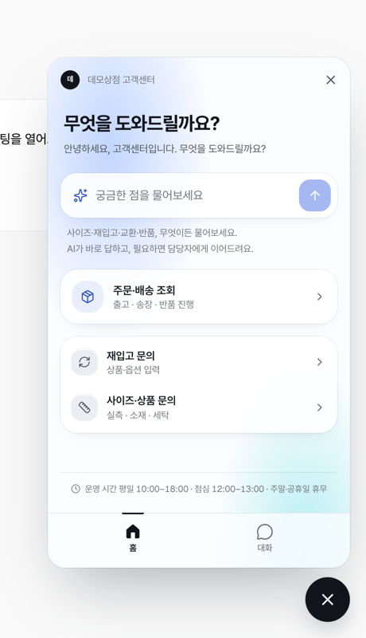
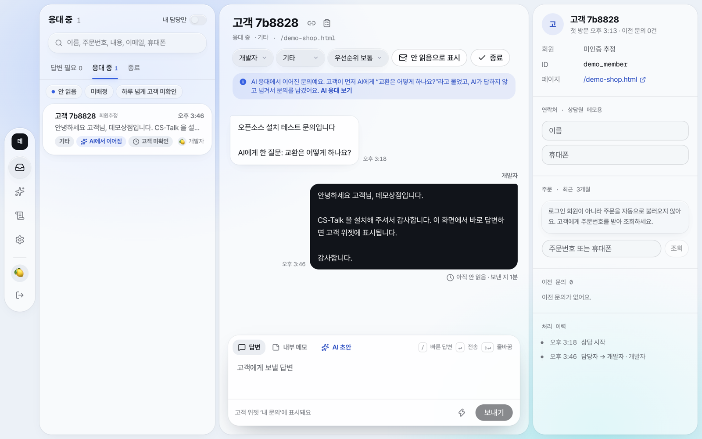
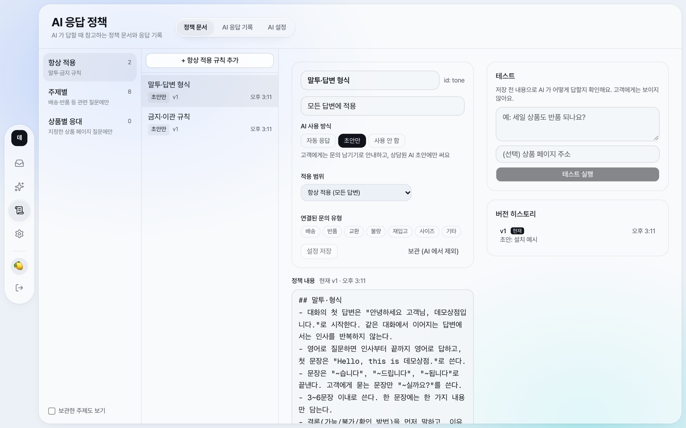

# CS-Talk for Cafe24

**Cafe24 쇼핑몰용 오픈소스 고객 문의 위젯 + AI 응답 + 상담 인박스.** 유료 상담 도구 대신 직접 띄워 쓸 수 있습니다.
Vercel + Postgres(Supabase) 위에서 돌아가고, 위젯을 열기 전에는 서버 호출이 없어서 방문자가 늘어도 비용이 거의 늘지 않습니다.

> An open-source customer-support widget, AI answers and agent inbox for Cafe24 (Korean e-commerce platform) shops. Next.js + Postgres. UI and docs are in Korean.

<table>
<tr>
<td width="30%"></td>
<td><br></td>
</tr>
<tr><td align="center">쇼핑몰 위젯</td><td align="center">인박스 · AI 응답 정책</td></tr>
</table>

## 무엇을 하나요

| 고객 (쇼핑몰 위젯) | 운영자 (콘솔) |
|---|---|
| **주문·배송 조회** — 회원은 바로, 비회원은 주문번호로 (Cafe24 API) | **인박스** — 문의 목록, 담당자 지정, 빠른 답변(`/단축어`), 읽음 표시 |
| **AI 에게 물어보기** — 운영자가 쓴 정책 문서·상품 정보만 근거로 답변 | **AI 응대** — AI 가 답한 대화 확인, 필요하면 대화에 바로 참여 |
| **문의 남기기** — 사진·동영상 첨부 | **AI 응답 정책** — 주제별 문서, 버전 기록, 자동 응답/초안 전용 선택 |
| 답변이 오면 위젯 배지 · (선택) 메일 알림 | 슬랙 알림 · 답변 지연 경고 · 일일 요약 · 변경 이력 |

- 위젯 설치는 콘솔 버튼 하나로 Cafe24 ScriptTag 에 들어갑니다 (스킨 파일 수정 없음).
- 새 기능은 **테스트 스킨**에서만 먼저 켜 보고 전체 공개할 수 있습니다.
- 불량·가품·법적 분쟁 같은 문의는 AI 를 거치지 않고 바로 사람에게 넘깁니다. AI 가 환불·교환을 약속하지 않도록 프롬프트와 서버 검사 둘 다로 막습니다.
- 고객 화면에는 상담원 실명 대신 설정한 고객센터 이름·로고 하나만 보입니다.

## 내 컴퓨터에서 바로 띄우기

필요한 것: **Node.js 22 이상**, **Docker Desktop** (또는 이미 쓰는 Postgres)

```bash
git clone https://github.com/Toomuch-Tax/cafe24-cs-talk.git
cd cafe24-cs-talk
npm install
docker compose up -d     # 로컬 Postgres (포트 54329)
npm run setup            # .env.local 생성·비밀키 채우기 → 테이블 → 예시 정책 → 관리자 계정
npm run dev
```

- 운영 콘솔: <http://localhost:3000/inbox> — 로그인 정보는 `.env.local` 의 `DEV_LOGIN_EMAIL` / `DEV_LOGIN_PASSWORD`
- 위젯 체험: <http://localhost:3000/demo-shop.html> — 가짜 쇼핑몰 화면 오른쪽 아래에 위젯이 뜹니다

Docker 없이 이미 Postgres 가 있다면 `.env.local` 의 `DATABASE_URL` 만 바꾸고 `npm run setup` 하세요. 데이터베이스가 없으면 setup 이 만듭니다.
`npm run setup` 은 여러 번 다시 실행해도 안전합니다 (이미 있는 값·정책은 건드리지 않음).

### 설정별로 되는 것

| 설정 | 없으면 | 넣으면 |
|---|---|---|
| (기본) | 문의 남기기, 인박스 답변, 정책 편집 | |
| `AI_GATEWAY_API_KEY` | AI 질문이 바로 "문의 남기기"로 넘어감 | AI 가 정책 문서로 답변, 상담원 답변 초안 |
| Cafe24 앱 (`CAFE24_*`) | 주문 조회·상품 정보·위젯 자동 설치 없음 | 전부 동작 |
| `SLACK_WEBHOOK_URL` | 알림 없음 | 새 문의·지연·일일 요약 알림 |
| `SUPABASE_URL` + 키 | 로컬은 `.data/uploads` 에 저장, 배포 환경에서는 첨부 꺼짐 | 사진·동영상 첨부 |
| `GOOGLE_CLIENT_*` | 이메일·비밀번호 로그인만 | 회사 구글 계정 로그인 |
| `RESEND_API_KEY` 등 | 메일 없음 | 위젯을 다시 열지 않은 비회원에게 답변 메일 |

## 내 쇼핑몰에 붙이기

1. **배포** — [docs/deploy.md](docs/deploy.md) (Vercel + Supabase)
2. **Cafe24 앱 만들기** — [docs/cafe24-app.md](docs/cafe24-app.md) 에서 Client ID 등을 받아 환경변수에 넣기
3. 콘솔 **설정 → Cafe24 연동 → Cafe24 연결** → 쇼핑몰 관리자 로그인·권한 승인
4. 같은 화면에서 **테스트** 위젯 설치 → "테스트 쇼핑몰 바로가기"로 확인 → 괜찮으면 **전체 공개** 설치
5. **AI 응답 정책**에서 예시 정책의 `[확인 필요]` 줄을 내 쇼핑몰 값으로 고치고, 주제별로 "자동 응답"을 켭니다

`[확인 필요]` 가 붙은 줄은 AI 에 전달되지 않습니다. 배송비·기간처럼 쇼핑몰마다 다른 값은 예시로만 들어 있으니 꼭 고쳐 주세요.

## 브랜드·문구 바꾸기

| 바꿀 것 | 어디서 |
|---|---|
| 브랜드 이름 (AI 인사·위젯 제목·메일 제목) | 환경변수 `NEXT_PUBLIC_BRAND_NAME`, `NEXT_PUBLIC_BRAND_NAME_EN` |
| 쇼핑몰 주소 (메일 링크·상품 링크·테스트 쇼핑몰) | `NEXT_PUBLIC_SHOP_URL` |
| 고객에게 보이는 답변 이름·로고 | 콘솔 설정 → 고객 노출 정보 |
| 인사말·영업 시간·부재 안내 | 콘솔 설정 |
| AI 말투·금지 규칙·정책 | 콘솔 AI 응답 정책 (`말투·답변 형식`, `금지·이관 규칙` 주제) |
| 색·폰트 | `src/app/globals.css` 의 토큰 |

`NEXT_PUBLIC_*` 값은 빌드할 때 들어가므로 바꾼 뒤 다시 배포해야 합니다.

## 구조

| 경로 | 역할 |
|---|---|
| `public/widget.js` | 쇼핑몰에 들어가는 작은 로더. 버튼만 그리고, 누르면 iframe 으로 `/widget` 을 연다 |
| `src/app/widget` | 고객 위젯 화면 |
| `src/app/(console)/{inbox,ai,policies,settings}` | 운영 콘솔 |
| `src/app/api/widget/*` | 방문자 API (서명된 방문자 토큰) |
| `src/app/api/{inbox,policies,ai,cafe24}/*` | 콘솔 API (세션 쿠키) |
| `src/app/api/cron/jobs` | 10분마다 도는 예약 작업 (알림 재시도, 지연 경고, 자동 종료, 정리) |
| `src/lib/ai/` | AI 응답 (`prompt.ts` 순수 로직, `engine.ts` DB·모델 호출) |
| `src/lib/cafe24/` | Cafe24 OAuth·주문·상품 |
| `src/lib/brand.ts` | 브랜드·쇼핑몰 주소 설정 |
| `src/lib/features.ts` | 기능 플래그 (`test` = 테스트 스킨에서만, `live` = 전체 공개) |
| `db/migrations/` | 스키마. 번호 순서대로 추가만 한다 |
| `scripts/` | `setup`, `migrate`, 계정 생성, 정책·빠른 답변 예시, 백업·복원 테스트 |

운영 방법(예약 작업, 알림, 백업, 장애 대응)은 [docs/operations.md](docs/operations.md).

## 명령어

```bash
npm run setup          # 처음 설치·재설치 (여러 번 실행해도 안전)
npm run dev            # 개발 서버
npm run check          # lint + 타입 검사 + 빌드
npm run db:migrate     # 새 마이그레이션 적용 (.env.local 기준)
AGENT_PASSWORD='…' node --env-file=.env.local scripts/create-agent.mjs you@example.com 이름 admin   # 계정 추가
```

## 기여

이슈·PR 환영합니다. 큰 변경은 이슈로 먼저 이야기해 주세요.

- 새 테이블을 만들면 RLS 를 켭니다 (Supabase 공개 REST 차단 — `0002_lock_down_public_api.sql` 참고).
- 고객 화면 새 기능은 `src/lib/features.ts` 에 `test` 로 먼저 넣습니다.
- 커밋 전 `npm run check`.

보안 문제는 공개 이슈 대신 [SECURITY.md](SECURITY.md) 의 방법으로 알려 주세요.

## 라이선스

[MIT](LICENSE)
